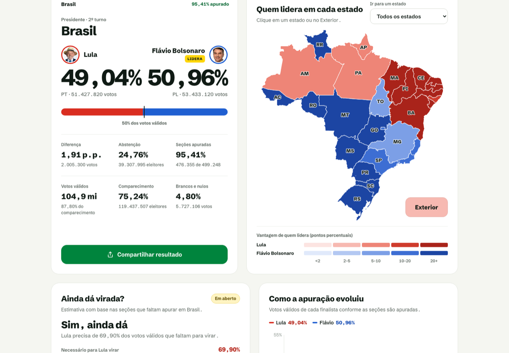
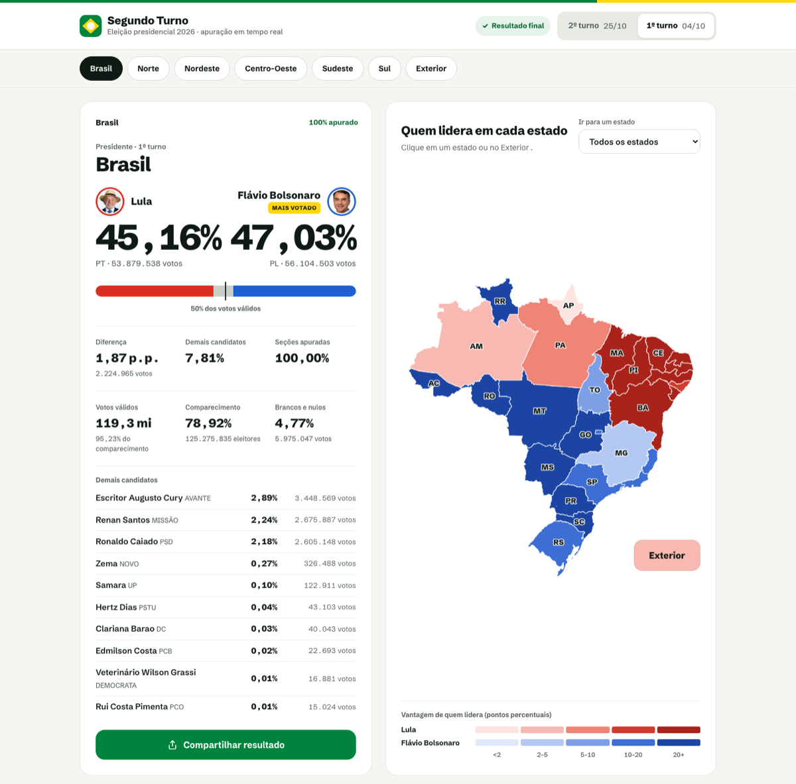
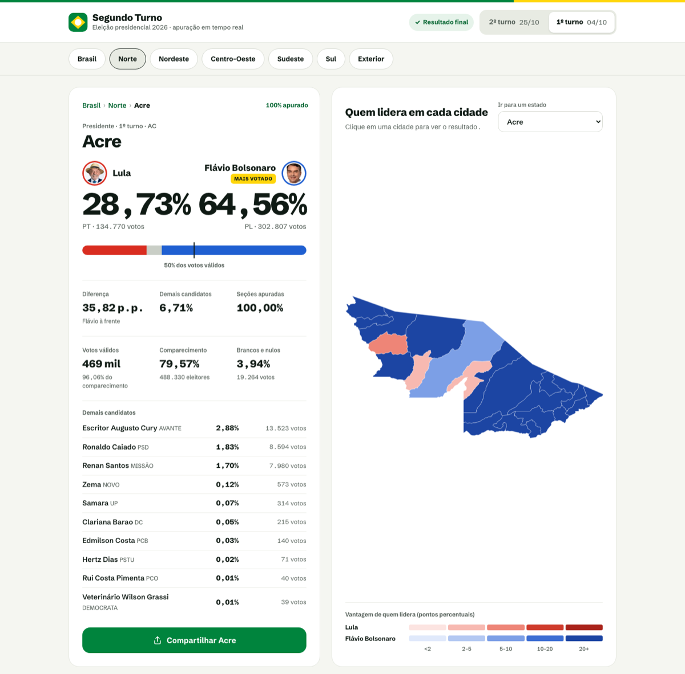
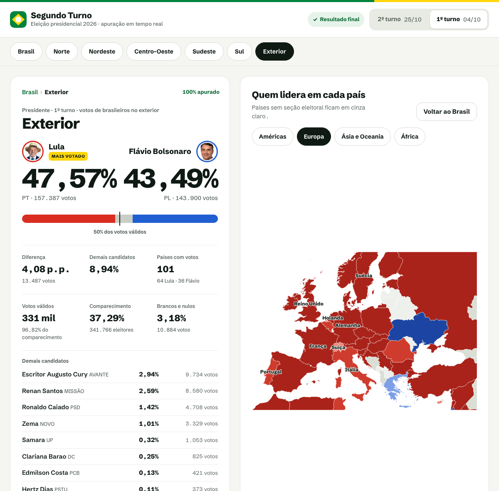
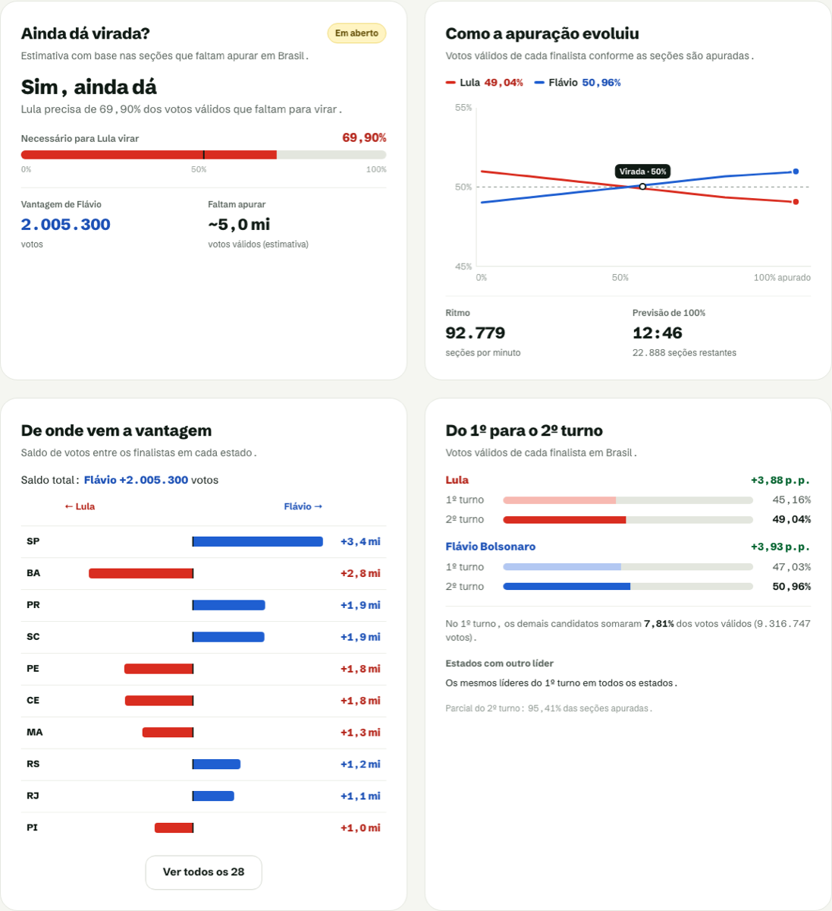
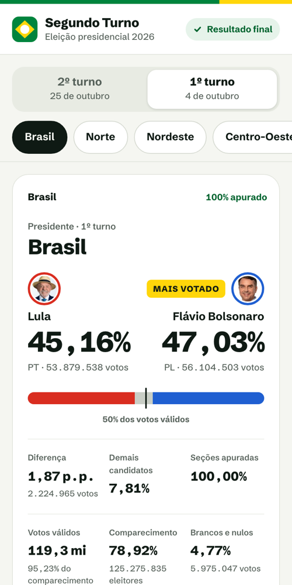
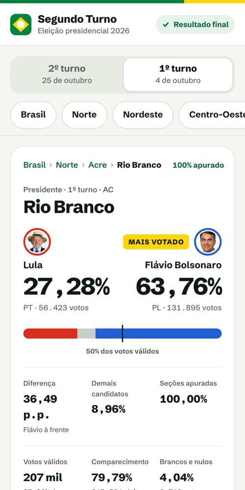
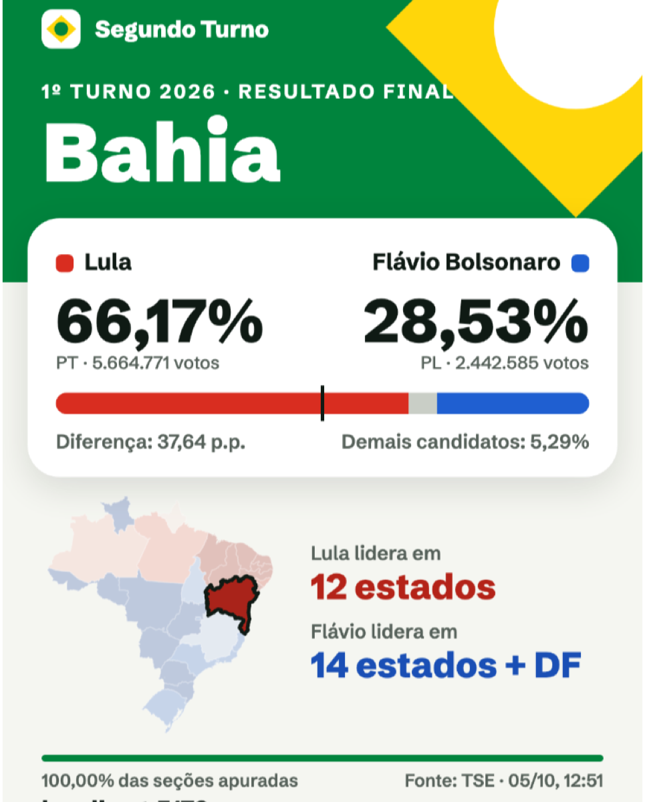

# Segundo Turno Brasil

Site para acompanhar **ao vivo** a apuração do **2º turno da eleição presidencial de 25/10/2026**. Ele mostra quem lidera no Brasil, em cada região, estado, cidade e país do exterior, com mapas interativos e imagens prontas para postar nos Stories. Os dados são os oficiais do TSE e se atualizam sozinhos a cada ~60 segundos.

**No ar em [eleicao.danielfigueroa.dev](https://eleicao.danielfigueroa.dev).**



<sub>2º turno em modo de simulação (`DATA_SOURCE=simulation`), com 74% das seções apuradas. As demais imagens usam o resultado oficial do 1º turno.</sub>

## O que dá para fazer no site

### Ver o placar de qualquer lugar do Brasil

Percentual e total de votos de cada finalista aparecem sempre, em qualquer abrangência. Logo abaixo vêm a diferença em pontos percentuais e em votos, as seções apuradas, os votos válidos, o comparecimento e os brancos e nulos. No 1º turno, o card lista também os demais candidatos.

O mapa pinta cada estado com a cor de quem lidera, mais forte quanto maior a vantagem (5 faixas, de menos de 2 a mais de 20 pontos). As cores seguem o candidato, foram escolhidas para quem tem daltonismo e sempre vêm acompanhadas de números e rótulos. Durante a apuração, o botão "Abstenção" troca o mapa para a abstenção em cada estado.



### Descer até a sua cidade

Tocar num estado abre o resultado dele, e o mapa passa a mostrar **os municípios do estado**. A lista "Votação por cidade" tem busca e ordena por eleitorado, por vantagem ou pelas urnas que faltam apurar. Cada cidade tem seu próprio card (com as migalhas Brasil › Norte › Acre › Rio Branco) e um link próprio para compartilhar, como `/#/ac/1200401`.



### Acompanhar o voto no exterior

Os votos de brasileiros no exterior já entram no total do Brasil e também podem ser vistos à parte. Há um **mapa por país, um continente por vez**, com cada país na cor de quem lidera. Também há uma lista por país com busca e filtro por continente, e tocar num país abre o resultado completo dele.



### Entender a apuração

Na noite do 2º turno, a seção de análise responde às perguntas mais comuns:

- **Ainda dá virada?** Mostra quanto dos votos que faltam apurar quem está atrás precisa conquistar.
- **Como a apuração evoluiu:** a curva de cada finalista, o ritmo em seções por minuto e a previsão de quando a apuração chega a 100%.
- **De onde vem a vantagem:** o saldo de votos estado a estado.
- **Do 1º para o 2º turno:** quanto cada finalista cresceu e onde o líder mudou.
- **Comparação com 2022:** como estava a apuração de 2022 no mesmo ponto e quais estados mudaram de líder.



### Usar no celular e compartilhar

O site foi feito primeiro para o celular: barra de abrangência fixa, alvos de toque de pelo menos 44px, e tocar num estado ou numa cidade leva direto ao resultado. O botão **Compartilhar** gera tudo no próprio aparelho, com o placar do momento:

- **imagem** nos formatos Stories (1080×1920) ou Feed (1080×1350), com o mapa colorido do lugar escolhido;
- **vídeo animado** de cerca de 6 segundos, em que os números sobem do zero e o mapa ganha cor aos poucos;
- **texto pronto para o WhatsApp**, com percentuais, votos, % apurado e o link do mesmo lugar;
- **código para incorporar** o placar ao vivo em blogs e portais (no computador);
- com o 2º turno decidido, a opção de compartilhar a vitória de quem venceu.

Imagem e vídeo vão pela folha de compartilhamento nativa (Instagram, WhatsApp…) ou podem ser baixados.

<table>
  <tr>
    <td align="center" width="33%"><br /><sub>Placar no celular</sub></td>
    <td align="center" width="33%"><br /><sub>Resultado de uma cidade</sub></td>
    <td align="center" width="33%"><br /><sub>Imagem para os Stories</sub></td>
  </tr>
</table>

### Outros detalhes

- **Abas 2º turno e 1º turno:** até a apuração do 2º turno começar, o site abre no resultado final do 1º. Antes das 17h de 25/10, mostra uma contagem regressiva.
- **Links compartilháveis:** o turno e a abrangência ficam na URL (`/#/sp`, `/#/regiao/ne`, `/#/exterior`, `/#/1turno/ba/2927408`).
- **Meu lugar:** "Fixar como minha cidade" (ou meu estado, meu país) cria um atalho com ★ na barra de abrangência, guardado só no navegador.
- **Placar no título da aba:** dá para acompanhar com o site aberto em segundo plano.
- **Confiável na noite da eleição:**
  - o placar se atualiza sozinho a cada 60 segundos, e o navegador não baixa nada quando os dados não mudaram;
  - o CDN absorve o tráfego, e a API só consulta o TSE quando o cache expira;
  - se o TSE oscilar, o site continua mostrando o último dado bom com o horário dele.
- **Leve e acessível:** cerca de 116 KB de JS inicial (gzip). Os mapas carregam sob demanda, o mapa navega por teclado, há contraste AA e o site respeita `prefers-reduced-motion`.

## Como funciona

```
Navegador (React)  ──polling ~60s──▶  CDN Vercel  ──cache expirado──▶  Função /api/* (TypeScript)  ──▶  TSE
```

- **API** (`apps/api`): funções da Vercel que leem os JSON públicos do TSE, validam com zod e respondem num contrato próprio. Não há banco de dados nem cron, e o cache do CDN define o ritmo das consultas. Rotas:
  - `/api/results`: Brasil, exterior e as 27 UFs;
  - `/api/abroad`: exterior por país e por cidade;
  - `/api/cities`: municípios de uma UF, com busca incremental;
  - `/api/history`: curva da apuração.
- **Web** (`apps/web`): React + Vite.
  - Os mapas são pré-projetados no build a partir das malhas do IBGE e do Natural Earth, então nada de d3 vai para o navegador.
  - A imagem de compartilhamento é desenhada em Canvas no próprio aparelho.
- **Contrato e domínio** (`packages/`): tipos e regras compartilhados entre back e front.

Detalhes em [docs/architecture.md](docs/architecture.md) e nas [ADRs](docs/adr/).

## Como rodar

Requisitos: Node 22 (`.nvmrc`) e pnpm 10 (`corepack enable` instala a versão de `packageManager`).

```bash
pnpm install
cp apps/api/.env.example apps/api/.env   # DATA_SOURCE=simulation por padrão
pnpm dev                                 # web em http://localhost:5173, API em :3001
```

### Fontes de dados (`DATA_SOURCE`)

| Valor        | Uso                                                                                    |
| ------------ | -------------------------------------------------------------------------------------- |
| `simulation` | 2º turno simulado "ao vivo" a partir do 1º turno (só os 2 finalistas); 1º turno final. |
| `fixture`    | Resultado final do 1º turno de 2026, estático (offline).                               |
| `tse`        | TSE ao vivo (produção): 2º turno (6258) e 1º turno (6257).                             |

Todas as variáveis estão em [`apps/api/.env.example`](apps/api/.env.example).

### Histórico da apuração (Vercel Blob)

A curva e o ritmo da apuração do 2º turno (`GET /api/history`) ficam num arquivo do Vercel Blob quando há um Blob store conectado ao projeto. Sem ele, ou fora de `DATA_SOURCE=tse`, o histórico fica em memória, o que basta para `pnpm dev`. Detalhes no [ADR 0011](docs/adr/0011-count-history-in-vercel-blob.md).

## Scripts

| Comando                             | O que faz                                                            |
| ----------------------------------- | -------------------------------------------------------------------- |
| `pnpm dev`                          | API (tsx watch) + web (Vite) em paralelo                             |
| `pnpm test`                         | Vitest em todos os pacotes                                           |
| `pnpm lint`                         | ESLint                                                               |
| `pnpm format:check`                 | Prettier                                                             |
| `pnpm typecheck`                    | `tsc` em todos os pacotes                                            |
| `pnpm build`                        | Build da web + `.vercel/output` (Build Output API da Vercel)         |
| `pnpm --filter @stb/web map:build`  | Regera o mapa pré-projetado a partir do IBGE                         |
| `pnpm --filter @stb/web map:world`  | Regera os mapas por continente do Exterior                           |
| `pnpm --filter @stb/web map:cities` | Regera as malhas municipais (`--download` baixa do IBGE)             |
| `pnpm --filter @stb/web og:build`   | Regera a imagem de prévia de links (`public/og.png`)                 |
| `pnpm --filter @stb/web data:2022`  | Regera o 2º turno de 2022 usado na comparação (dados abertos do TSE) |

## Estrutura

```
apps/api           API (Vercel Functions): TSE → domínio → JSON cacheado no CDN
apps/web           React + Vite: placar, mapas (Brasil, municípios, mundo), listas, compartilhamento
packages/domain    Regras puras: UFs, regiões, agregação, liderança
packages/contracts Contrato da API (zod/mini), usado pelo back e pelo front
docs/              Arquitetura, API, dados do TSE, frontend e ADRs
```

## Deploy

Publicado na Vercel. O `vercel.json` roda `pnpm build`, que gera `.vercel/output`, e a Vercel publica esse diretório como está. Detalhes em [docs/architecture.md](docs/architecture.md).

## Documentação

- [Arquitetura](docs/architecture.md)
- [API](docs/api.md)
- [Dados do TSE](docs/tse-data.md)
- [Frontend](docs/frontend.md)
- [Decisões de arquitetura (ADRs)](docs/adr/)

## Aviso

Site independente, sem vínculo com o TSE ou com candidatos. Os resultados oficiais são os publicados pelo [TSE](https://resultados.tse.jus.br).

## Licença

[GPL-3.0](LICENSE)
